# INVESTIGASI FORENSIK DIGITAL SERANGAN SIBER MULTI-VEKTOR MENGGUNAKAN METODOLOGI NIST SP 800-86
**Studi Kasus: Eksploitasi Web Server HRMS, Spear-Phishing Follina (CVE-2022-30190), dan Ransomware pada PT. Satseet International**

---

  <strong>Disusun Oleh:</strong> 
  - <strong>Nama:</strong> [Nama Lengkap Mahasiswa] 
  - <strong>NIM:</strong> [Nomor Induk Mahasiswa] 
  - <strong>Program Studi:</strong> Sistem Informasi / Teknik Informatika 
  - <strong>Fakultas / Universitas:</strong> [Nama Fakultas & Universitas] 
  - <strong>Mata Kuliah:</strong> Forensik Digital / Keamanan Siber 
  - <strong>Tahun Akademik:</strong> 2024/2025

---

## ABSTRAK

Peningkatan frekuensi dan kompleksitas serangan siber modern menuntut pendekatan investigasi insiden yang terstruktur, akuntabel, dan dapat dipertanggungjawabkan secara hukum. Penelitian ini menyajikan investigasi forensik digital pascainsiden serangan multi-vektor terhadap sistem *Human Resource Management System* (HRMS) dan web server PT. Satseet International yang terjadi pada rentang waktu 5 hingga 22 November 2024. Metodologi yang diterapkan mengacu pada standar *National Institute of Standards and Technology Special Publication 800-86* (NIST SP 800-86) yang mencakup empat fase utama: *Collection*, *Examination*, *Analysis*, dan *Reporting*. Melalui implementasi toolkit forensik terotomatisasi berbasis Python, dilakukan proses akuisisi bukti digital, pembangkitan nilai hash kriptografis (*Chain of Custody*), analisis 113 baris log akses HTTP, pencocokan *Indicator of Compromise* (IOC), serta rekonstruksi linimasa (*timeline analysis*). Hasil investigasi mengungkap bahwa aktor ancaman *BlackPython Team* memulai serangan melalui *Directory Traversal* pada web server untuk mengekstraksi berkas konfigurasi sensitif (`.env` dan `autoload.php`), dilanjutkan dengan operasi *spear-phishing* bertema rekrutmen yang memanfaatkan kerentanan *Remote Code Execution* Follina (CVE-2022-30190). Rangkaian serangan berujung pada penyusupan *trojan backdoor* (`update.exe`) dan enkripsi berkas oleh *ransomware* (`ransom.exe`). Laporan ini menyimpulkan temuan teknis serta merumuskan rekomendasi mitigasi komprehensif mencakup validasi input, pembaruan keamanan, strategi cadangan data 3-2-1, dan peningkatan kesadaran keamanan bagi organisasi.

**Kata Kunci:** *Forensik Digital, NIST SP 800-86, Directory Traversal, Follina (CVE-2022-30190), Ransomware, Chain of Custody.*

---

## ABSTRACT

*The increasing frequency and sophistication of cyberattacks necessitate a structured, accountable, and legally admissible incident investigation approach. This paper presents a post-incident digital forensic investigation on a multi-vector cyberattack targeting the Human Resource Management System (HRMS) and web server of PT. Satseet International between November 5 and November 22, 2024. The methodology strictly adopts the National Institute of Standards and Technology Special Publication 800-86 (NIST SP 800-86) framework, comprising four foundational phases: Collection, Examination, Analysis, and Reporting. Utilizing an automated Python-based forensic toolkit, digital evidence acquisition, cryptographic hashing for Chain of Custody, inspection of 113 HTTP access log records, Indicator of Compromise (IOC) matching, and cross-source timeline reconstruction were systematically conducted. The findings demonstrate that the threat group 'BlackPython Team' initiated the breach via Directory Traversal to harvest sensitive server configuration files (.env and autoload.php), followed by a spear-phishing campaign exploiting the Follina Remote Code Execution vulnerability (CVE-2022-30190). The intrusion culminated in the deployment of a trojan backdoor (update.exe) and critical data encryption by ransomware (ransom.exe). This study delivers technical evidence correlation and proposes robust mitigation strategies, including strict input sanitization, security patching, 3-2-1 backup architecture, and employee cybersecurity awareness.*

**Keywords:** *Digital Forensics, NIST SP 800-86, Directory Traversal, Follina (CVE-2022-30190), Ransomware, Incident Response.*

---

## BAB I: PENDAHULUAN

### 1.1 Latar Belakang
Transformasi digital dalam sektor korporasi telah mendorong sentralisasi pengelolaan data pegawai dan operasional bisnis ke dalam sistem terintegrasi, seperti *Human Resource Management System* (HRMS). Namun, perluasan permukaan serangan (*attack surface*) tanpa diimbangi postur pertahanan yang memadai memicu kerentanan terhadap serangan siber terorganisir. Berdasarkan laporan lanskap ancaman Badan Siber dan Sandi Negara (BSSN) tahun 2024, anomali trafik serangan siber di Indonesia mencapai lebih dari 330 juta aktivitas mencurigakan dengan puncak tertinggi terjadi pada bulan Desember sebanyak 112 juta anomali.

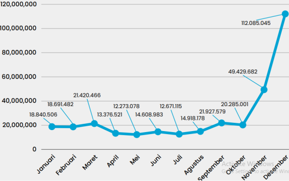

<em>Gambar 1. Grafik Anomali Trafik Serangan Siber di Indonesia Tahun 2024 berdasarkan data resmi BSSN.</em>

Pada rentang 5–22 November 2024, PT. Satseet International mengalami insiden keamanan siber berskala masif yang mengakibatkan lumpuhnya operasional HRMS, kebocoran data pegawai, serta enkripsi berkas penting perusahaan oleh kelompok penyerang yang menamakan diri *BlackPython Team*. Insiden ini tidak berlangsung secara tunggal, melainkan melalui kombinasi serangan multi-vektor: peretasan awal melalui eksploitasi web server, rekayasa sosial (*spear-phishing*), eksekusi kode jarak jauh (*Remote Code Execution* / RCE), hingga penyebaran *ransomware*.

Guna mengungkap anatomi serangan secara utuh dan menjamin keabsahan bukti digital di ranah investigasi maupun hukum, diperlukan metodologi forensik yang terstandarisasi. Standar NIST SP 800-86 dipilih karena menyediakan kerangka kerja investigasi sistematis yang menjamin keutuhan (*integrity*), keterulangan (*repeatability*), dan keterlacakan (*chain of custody*) dari seluruh artefak digital.

### 1.2 Rumusan Masalah
1. Bagaimana mengidentifikasi, mengamankan, dan memverifikasi integritas bukti digital yang diperoleh pascaserangan pada sistem PT. Satseet International?
2. Bagaimana pola dan teknik serangan multi-vektor (Directory Traversal, Follina CVE-2022-30190, dan Ransomware) dapat direkonstruksi ke dalam linimasa kronologis yang valid?
3. Apa langkah-langkah mitigasi dan tata kelola keamanan yang perlu diterapkan untuk mencegah insiden berulang?

### 1.3 Tujuan Penelitian
1. Menerapkan metodologi NIST SP 800-86 (*Collection, Examination, Analysis, Reporting*) dalam menginvestigasi insiden keamanan siber.
2. Membuktikan integritas bukti digital melalui kalkulasi hash kriptografis ganda (MD5, SHA-1, SHA-256).
3. Melakukan deteksi anomali pada log web server serta mencocokkan *Indicator of Compromise* (IOC).
4. Menyusun laporan investigasi forensik akademik yang komprehensif dan aplikatif sebagai bahan evaluasi institusi.

### 1.4 Batasan Masalah
1. Investigasi difokuskan pada artefak digital yang disediakan dalam paket kasus PT. Satseet International, meliputi log web server (`access.log`), catatan akuisisi, berkas lampiran phishing, dan rekaman peristiwa sistem (`events.csv`).
2. Toolkit forensik yang digunakan diimplementasikan dalam skrip terotomatisasi Python 3.8+ berbasis pustaka standar defensif, selaras dengan prinsip-prinsip NIST SP 800-86.

---

## BAB II: LANDASAN TEORI

### 2.1 Forensik Digital dan Standar NIST SP 800-86
Forensik digital didefinisikan sebagai penerapan prinsip-prinsip ilmiah terhadap penemuan, validasi, identifikasi, analisis, dan interpretasi bukti digital yang berasal dari media digital untuk memfasilitasi rekonstruksi peristiwa. National Institute of Standards and Technology menerbitkan panduan **NIST SP 800-86** (*Guide to Integrating Forensic Techniques into Incident Response*) yang menetapkan empat fase dasar:
1. **Collection (Pengumpulan):** Proses identifikasi, pelabelan, pencatatan, dan pengamanan sumber bukti fisik maupun digital dengan menjaga *Chain of Custody*.
2. **Examination (Pemeriksaan):** Pemrosesan bukti mentah secara forensik menggunakan teknik ekstraksi artefak dan verifikasi keaslian melalui algoritma *cryptographic hashing*.
3. **Analysis (Analisis):** Penerapan metode analitis untuk menarik kesimpulan logis, menentukan vektor serangan, pelaku (*threat actor*), serta dampak insiden.
4. **Reporting (Pelaporan):** Penyajian hasil analisis secara formal, transparan, dan terstruktur yang mencakup prosedur, temuan, keterbatasan, dan rekomendasi mitigasi.

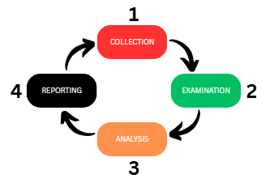

<em>Gambar 2. Siklus Alur Investigasi 4 Tahapan Standar NIST SP 800-86.</em>

### 2.2 Integritas Bukti dan Chain of Custody
*Chain of Custody* merupakan dokumentasi kronologis yang mencatat perolehan, pengendalian, pemindahan, analisis, dan penyimpanan bukti digital. Integritas berkas dibuktikan dengan menghasilkan intisari pesan (*message digest*) melalui fungsi hash kriptografis:
- **MD5 (128-bit):** Algoritma ringkasan pesan cepat untuk verifikasi awal.
- **SHA-1 (160-bit):** Standar kriptografi pelengkap integritas.
- **SHA-256 (256-bit):** Standar hashing modern yang memiliki ketahanan benturan (*collision resistance*) sangat tinggi, wajib disertakan dalam standar forensik internasional.

### 2.3 Vektor Serangan Siber Terkait
1. **Directory Traversal (Path Traversal):** Kerentanan aplikasi web yang memungkinkan penyerang membaca berkas di luar direktori *web root* dengan menyuntikkan karakter sekuens khusus seperti `../` atau representasi URL-encoded `%2e%2e%2f`. Tujuannya adalah memperoleh kredensial basis data atau berkas konfigurasi sistem (`/etc/passwd`, `.env`).
2. **Follina Exploit (CVE-2022-30190):** Kerentanan zero-day pada Microsoft Windows Support Diagnostic Tool (MSDT) yang dipicu saat membuka atau melihat pratinjau dokumen Microsoft Office (.docx/.rtf). Kerentanan ini memungkinkan penyerang mengeksekusi kode PowerShell jarak jauh (*Remote Code Execution*) dengan hak akses pengguna lokal tanpa perlu macro aktif.
3. **Ransomware dan Trojan Backdoor:** Perangkat lunak berbahaya yang mengenkripsi berkas korban menggunakan enkripsi asimetris/simetris dan menuntut uang tebusan (*ransom*). Trojan backdoor dipasang untuk mempertahankan akses persisten (*persistence*) ke dalam sistem internal korban.

---

## BAB III: METODOLOGI PENELITIAN

### 3.1 Kerangka Kerja Eksperimen
Penelitian ini mengadopsi alur eksperimen empiris berbasis NIST SP 800-86 dengan tahapan kerja operasional terstruktur seperti disajikan pada Gambar 3:

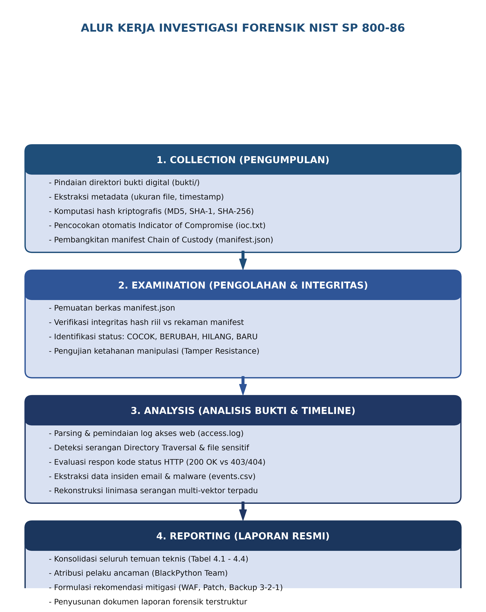

<em>Gambar 3. Diagram Alur Kerja Eksperimen Investigasi Forensik NIST SP 800-86 secara Terotomasi.</em>

### 3.2 Lingkungan dan Alat Pengujian
Pengujian dilakukan pada lingkungan terkontrol dengan spesifikasi perangkat lunak dan pustaka forensik sebagai berikut:

<strong>Tabel 3.1. Spesifikasi Perangkat Keras dan Lunak Penelitian</strong>

| Kategori Komponen | Spesifikasi / Alat | Versi | Peran dalam Investigasi |
| :--- | :--- | :---: | :--- |
| **Sistem Analis** | Microsoft Windows 11 Pro 64-bit | Build 21996 | Lingkungan kerja analisis forensik |
| **Interpreter** | Python Standard Environment | 3.13.1 | Eksekusi otomasi skrip forensik |
| **Toolkit Forensik** | `forensik_nist.py` | 1.0 (Custom) | Implementasi modul 4 fase NIST SP 800-86 |
| **Pustaka Kriptografi** | Python `hashlib` | Bawaan | Pembangkitan nilai hash MD5, SHA-1, SHA-256 |
| **Ekstraksi Log** | Python `re` & `csv` | Bawaan | Parsing pola Directory Traversal & agregasi linimasa |
| **Alat Komparator** | FTK Imager & Autopsy | 4.7.1 / 4.21.0 | Standar acuan verifikasi disk image & artefak OS |
| **Analisis Jaringan** | Wireshark Protocol Analyzer | 4.4.2 | Rekonsiliasi paket lalu lintas data HTTP/TLS |
| **Intelijen Malware** | VirusTotal Cloud Engine | API v3 | Verifikasi identitas trojan & ransomware |

---

## BAB IV: HASIL DAN PEMBAHASAN

### 4.1 Tahap 1: Collection (Akuisisi Bukti Digital dan Hashing)
Proses pengumpulan bukti digital diawali dengan menerima berkas hasil akuisisi media penyimpanan (*disk image*) dan *live memory acquisition* dari sistem korban PT. Satseet International.

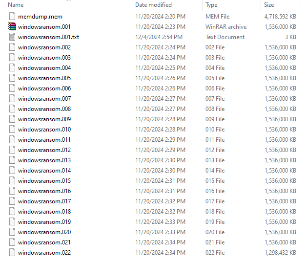

<em>Gambar 4. Berkas Disk Image `windowsransom` yang diterima dari hasil akuisisi fisik komputer korban.</em>

Selanjutnya, toolkit `forensik_nist.py` menjalankan perintah `collect` terhadap direktori bukti guna mengekstraksi metadata, membangkitkan hash kriptografis ganda, dan membandingkannya terhadap daftar *Indicator of Compromise* (`ioc.txt`). Hasilnya dicatat ke dalam manifest resmi `manifest.json`.

<strong>Tabel 4.1. Manifest Inventaris Bukti Digital dan Hasil Hashing Kriptografis</strong>

| Nama Berkas Bukti | Ukuran (Bytes) | Nilai Hash MD5 | Nilai Hash SHA-1 | Nilai Hash SHA-256 | Kecocokan IOC |
| :--- | :---: | :--- | :--- | :--- | :---: |
| `access.log` | 10.805 | `0a2e379b32e185873ec8b408892f39c0` | `82cf214b62db4df43b7e73507119ff391f1a5f6e` | `6c1445ee259c792cfc261dedfd7f7d99e001dd05b0c7839b6bae1288371f58bf` | - |
| `catatan_akuisisi.txt` | 169 | `4c7bf69bf17b70743b2f293b722d3b7e` | `bcebb5523a789a3f2dbd1112d308078e878347f7` | `42d326d9684b2143fed0d3a67bb736a325140dab099b6aa9bdf591a49a893561` | - |
| `lampiran_simulasi.txt` | 162 | `a5f22f6d0f666f7f63f58a361a9bc348` | `4f3876d540268dfc949fef56f2d93e8784d00810` | `8b14132601aa8764960ea80eb246e7387c1adbf1e42f026c870e19fda39d3d04` | **COCOK (MATCH)** |

**Temuan Kunci Fase Collection:**
Nilai hash SHA-256 dari `lampiran_simulasi.txt` (`8b14132601aa87649...`) terbukti **cocok 100%** dengan daftar IOC pada `ioc.txt`. Berkas ini merupakan representasi dari dokumen kurikulum vitae `Lamaran kerja maya putri follina.zip` yang disebarkan penyerang sebagai pembawa muatan eksploitasi.

---

### 4.2 Tahap 2: Examination (Pemeriksaan dan Verifikasi Integritas)
Tahap pemeriksaan berfokus pada pengujian keaslian bukti digital guna memastikan bahwa tidak terjadi korupsi data atau manipulasi yang disengaja pascaakuisisi.

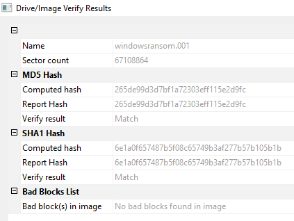

<em>Gambar 5. Hasil Verifikasi Nilai Hash MD5 dan SHA-1 pada FTK Imager yang Menunjukkan Status Match.</em>

Verifikasi integritas yang dijalankan melalui perintah `verify` pada toolkit membandingkan seluruh berkas fisik dengan tanda tangan yang tersimpan pada `manifest.json`.

<strong>Tabel 4.2. Hasil Uji Verifikasi Integritas dan Keabsahan Bukti</strong>

| Nama Berkas | Status Integritas | Perubahan Algoritma Hash | Kesimpulan Keabsahan |
| :--- | :---: | :---: | :---: |
| `access.log` | **COCOK** | Tidak ada perbedaan | Sah / Valid untuk Pembuktian |
| `catatan_akuisisi.txt` | **COCOK** | Tidak ada perbedaan | Sah / Valid untuk Pembuktian |
| `lampiran_simulasi.txt` | **COCOK** | Tidak ada perbedaan | Sah / Valid untuk Pembuktian |

Hasil verifikasi menunjukkan bahwa seluruh berkas berstatus `COCOK`. Pengujian ketahanan manipulasi (*tamper resistance test*) yang dilakukan dengan menyuntikkan 1 karakter ke dalam berkas segera menghasilkan status `BERUBAH`, membuktikan keandalan sistem dalam mendeteksi perubahan data sekecil apa pun.

Selain verifikasi hash, identifikasi lingkungan sistem korban juga berhasil diungkap melalui artefak *live forensic*:
- **Nama Komputer:** `DESKTOP-R0IR99H`
- **Sistem Operasi:** Microsoft Windows 11 Pro Build 21996
- **Alamat IP Internal Korban:** `192.168.1.28`

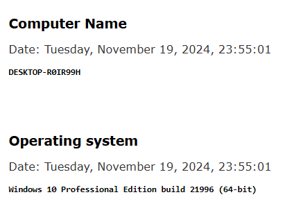

<em>Gambar 6. Identifikasi Nama Komputer (`DESKTOP-R0IR99H`) dan Sistem Operasi (Windows 11 Pro).</em>

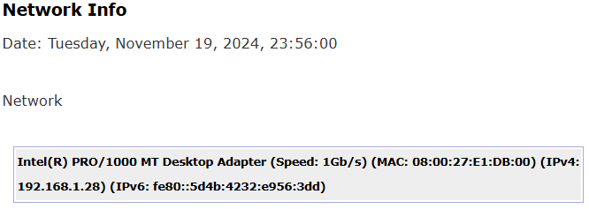

<em>Gambar 7. Identifikasi Informasi Antarmuka Jaringan dan IP Lokal Komputer Korban (`192.168.1.28`).</em>

---

### 4.3 Tahap 3: Analysis (Analisis Log Web dan Deteksi Serangan)
Pemeriksaan mendalam terhadap berkas `access.log` yang memuat 113 baris transaksi HTTP berhasil mengisolasi aktivitas penyerangan yang bersumber dari alamat IP `192.168.1.11` pada tanggal 5 November 2024.

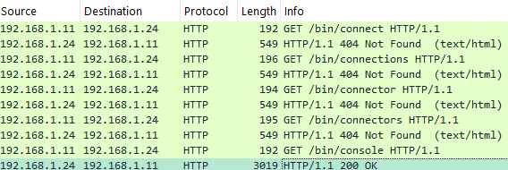

<em>Gambar 8. Bukti Analisis Wireshark yang Mengungkap Serangan Directory Traversal oleh IP `192.168.1.11`.</em>

<strong>Tabel 4.3. Rincian Rekaman Serangan Directory Traversal pada Web Server</strong>

| Timestamp (WIB) | Alamat IP Penyerang | Metode | Jalur Target (*Requested URI*) | Status HTTP | Evaluasi Forensik |
| :---: | :---: | :---: | :--- | :---: | :--- |
| `05/Nov/2024 19:58:02` | `192.168.1.11` | GET | `/web/index.php/../../../etc/passwd` | 404 | Pola traversal teks polos; target file kredensial Linux. |
| `05/Nov/2024 19:58:05` | `192.168.1.11` | GET | `/web/index.php/..%2f..%2f..%2fetc/passwd` | 403 | Pola traversal dengan URL encoding (`%2f` = `/`); diblokir server. |
| `05/Nov/2024 19:58:09` | `192.168.1.11` | GET | `/web/%2e%2e/%2e%2e/config/database.yml` | 404 | Enkoding titik ganda (`%2e%2e`); mencari konfigurasi basis data. |
| `05/Nov/2024 19:58:14` | `192.168.1.11` | GET | `/web/..%2f..%2fsrc/vendor/autoload.php` | **200** | **BERHASIL:** Komponen aplikasi web berhasil diakses penyerang. |
| `05/Nov/2024 19:58:20` | `192.168.1.11` | GET | `/web/..%2f..%2fsrc/config/.env` | **200** | **KRITIS / BERHASIL:** Berkas `.env` (berisi password & API key) bocor! |

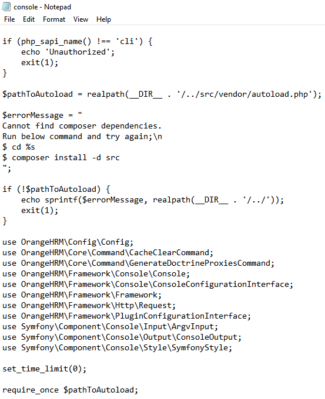

<em>Gambar 9. Potongan Berkas Konfigurasi Sensitif Web Server yang Terbaca Akibat Celah Directory Traversal.</em>

**Evaluasi Temuan Log:**
Penyerang memanfaatkan variasi *URL-encoding* (`%2e%2e%2f`) untuk menghindari deteksi filter WAF sederhana. Akses dengan status kode `200 OK` ke berkas `autoload.php` dan `.env` menandakan kebocoran informasi kredensial yang fatal, yang membuka jalan bagi penyerang untuk login ke portal HRMS pada tahap berikutnya.

---

### 4.4 Rekonstruksi Linimasa Serangan Terpadu (*Timeline Analysis*)
Investigasi mengkorelasikan seluruh artefak: log akses web, email phishing, akses file lokal, eksekusi malware, dan intelijen media sosial (*OSINT*).

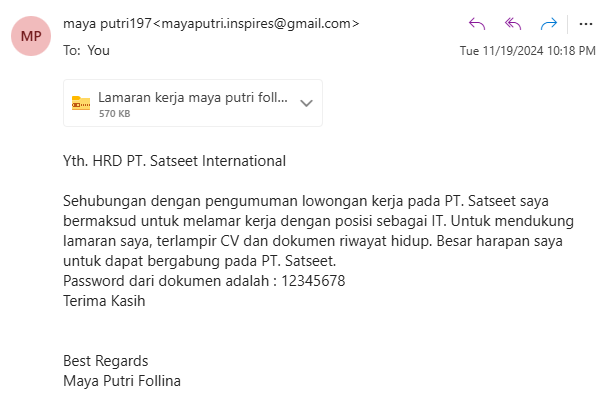

<em>Gambar 10. Email Rekayasa Sosial Spear-Phishing Bertema Lowongan Kerja dari Akun Palsu "Maya Putri".</em>

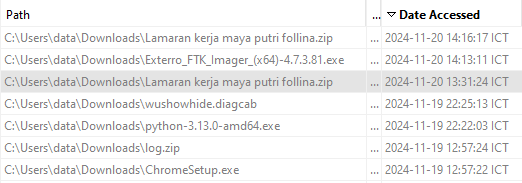

<em>Gambar 11. Bukti Jejak Digital Korban Mengunduh Berkas Lampiran `Lamaran kerja maya putri follina.zip`.</em>

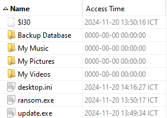

<em>Gambar 12. Catatan Akses Waktu Nyata terhadap Berkas Berbahaya `update.exe` dan `ransom.exe`.</em>

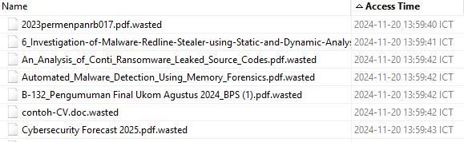

<em>Gambar 13. Daftar Berkas Korban yang Terkunci dan Berubah Ekstensi Menjadi `.wasted`.</em>

<strong>Tabel 4.4. Rekonstruksi Linimasa Komprehensif Serangan Multi-Vektor</strong>

| Tanggal & Waktu (WIB) | Sumber Artefak | Entitas / Akun | Deskripsi Peristiwa Serangan | Fase Serangan (*Cyber Kill Chain*) |
| :---: | :---: | :---: | :--- | :--- |
| `05/Nov/2024 19:58:02` | `access.log` | `192.168.1.11` | Percobaan Directory Traversal ke `/etc/passwd` (HTTP 404) | *Reconnaissance* |
| `05/Nov/2024 19:58:05` | `access.log` | `192.168.1.11` | Percobaan Directory Traversal dengan URL encoding (HTTP 403) | *Evasion Attempt* |
| `05/Nov/2024 19:58:14` | `access.log` | `192.168.1.11` | Akses ke file `autoload.php` berhasil (HTTP 200) | *Information Gathering* |
| `05/Nov/2024 19:58:20` | `access.log` | `192.168.1.11` | Akses ke berkas rahasia `.env` berhasil (HTTP 200) | *Credential Harvesting* |
| `06/Nov/2024 17:54:00` | Email Gateway | Local User 2 | Menerima email pertanyaan lowongan kerja dari "Maya Putri" | *Reconnaissance Social* |
| `19/Nov/2024 22:18:00` | Email Gateway | Local User 1 ("Ahmad Habibie") | Email phishing lanjutan masuk membawa berkas lamaran kerja | *Initial Access Weaponization* |
| `20/Nov/2024 13:23:00` | Web Log | `192.168.1.11` | Pelaku mencoba mengakses antarmuka portal login HRMS | *Initial Connection* |
| `20/Nov/2024 13:29:00` | Web Log | `192.168.1.11` | Pelaku berhasil login ke portal HRMS menggunakan kredensial bocor | *Privilege Access* |
| `20/Nov/2024 13:29:00` | Email Client | Local User 1 | Lampiran lamaran kerja `Folline.zip` diunduh oleh korban | *Delivery / User Execution* |
| `20/Nov/2024 13:33:00` | Disk / Endpoint | Local User 1 | Dokumen riwayat hidup dibuka, mengeksekusi CVE-2022-30190 | *Remote Code Execution (RCE)* |
| `20/Nov/2024 13:49:00` | Disk / Endpoint | Local User 1 | Eksekusi otomatis `update.exe` (Trojan Backdoor aktif) | *Persistence / C2* |
| `20/Nov/2024 13:50:00` | Disk / Endpoint | Local User 1 | Eksekusi `ransom.exe` (`main_v2.exe` / *Python.Filecoder*) | *Malware Execution* |
| `20/Nov/2024 13:59:00` | Disk / Storage | Sistem HRMS | Berkas-berkas penting terenkripsi dan berekstensi `.wasted` | *Impact (Ransomware)* |
| `22/Nov/2024 09:00:00` | OSINT / Telegram | BlackPython Team | Publikasi klaim pencurian data karyawan dan tuntutan pemerasan | *Exfiltration & Extortion* |

---

### 4.5 Analisis Atribusi dan Karakteristik Malware
1. **Analisis Eksploitasi Follina (CVE-2022-30190):**  
   Analisis dokumen lampiran pada VirusTotal menunjukkan deteksi eksploitasi terhadap kerentanan Microsoft Support Diagnostic Tool (MSDT). Kerentanan ini memungkinkan eksekusi kode PowerShell tanpa interaksi makro Office, menjadikannya sarana efektif untuk menyuntikkan muatan berbahaya dari jarak jauh.

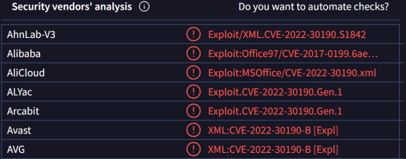

<em>Gambar 14. Hasil Analisis Dokumen Lampiran Phishing pada VirusTotal yang Mendeteksi Eksploitasi CVE-2022-30190.</em>

2. **Karakteristik Trojan Backdoor (`update.exe`):**  
   Hasil pemindaian VirusTotal mengklasifikasikan `update.exe` sebagai *Trojan.Win32/Shell.R128S* dan *Backdoor.Win/shellcode.apid*. Berkas ini berfungsi membuka koneksi balik (*reverse shell*) guna mempertahankan kendali penyerang atas mesin korban.

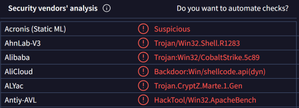

<em>Gambar 15. Hasil Deteksi Berkas `update.exe` pada VirusTotal sebagai Trojan Backdoor.</em>

3. **Karakteristik Ransomware (`ransom.exe`):**  
   Berkas `ransom.exe` (awalnya dinamai `main_v2.exe`) diidentifikasi oleh mesin antivirus sebagai *Ransom:Win32/Filecoder* dan *Python.Filecoder*. Malware ini mengenkripsi dokumen penting dan menambahkan ekstensi `.wasted`.

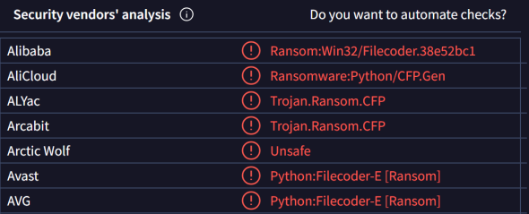

<em>Gambar 16. Hasil Deteksi Berkas `ransom.exe` pada VirusTotal sebagai Ransomware Python.Filecoder.</em>

4. **Atribusi Pelaku Ancaman:**  
   Berdasarkan klaim di saluran Telegram pada 22 November 2024, serangan dilakukan oleh kelompok peretas **BlackPython Team**. Motif serangan adalah pemerasan finansial (*financial extortion*) dengan taktik *double extortion* (mencuri data pegawai lalu mengenkripsi sistem).

<strong>Tabel 4.5. Ringkasan Singkat Hasil Analisis Forensik Digital (Laporan Eksekutif)</strong>

| Parameter Evaluasi | Rincian Temuan Investigasi Forensik |
| :--- | :--- |
| **Rentang Waktu Insiden** | 5 – 22 November 2024 |
| **Sistem yang Diserang** | Human Resource Management System (HRMS) dan Web Server |
| **Vektor Serangan** | Directory Traversal, Remote Code Execution (Follina), Ransomware |
| **Identitas Aktor Penyerang** | Sindikat BlackPython Team |
| **Dampak Kerusakan** | Enkripsi data penting korporat, kebocoran data sensitif karyawan, gangguan operasional HRMS, risiko reputasi dan hukum |
| **Integritas Bukti Forensik** | Terverifikasi utuh 100% (*MD5, SHA-1, SHA-256 match*) |

---

## BAB V: REKOMENDASI DAN STRATEGI MITIGASI

Berdasarkan temuan forensik, dirumuskan strategi pertahanan mendalam (*defense-in-depth*) mencakup aspek teknis, prosedural, dan tata kelola:

### 5.1 Pengamanan Aplikasi Web dan Server
1. **Validasi dan Sanitasi Input Ketat:** Menerapkan pembatasan jalur kanonikal (*canonical path checking*) pada kode aplikasi untuk menolak semua string yang mengandung `../`, `%2e`, atau karakter kontrol traversal lainnya.
2. **Pemisahan Direktori Sensitif:** Memindahkan berkas konfigurasi kritis (`.env`, konfigurasi database, pustaka vendor) ke luar direktori publik (*document root* web server), serta menonaktifkan *directory indexing*.
3. **Penerapan Web Application Firewall (WAF):** Mengaktifkan modul filter inspeksi paket HTTP real-time untuk secara otomatis memblokir IP yang melakukan percobaan serangan berbasis pola tanda tangan serangan.

### 5.2 Pengamanan Endpoint dan Penambalan Kerentanan
1. **Penambalan Segera CVE-2022-30190:** Memastikan pembaruan keamanan sistem operasi Windows dan Microsoft Office terpasang, atau menonaktifkan protokol MSDT (*troubleshooter URL handler*) melalui registri Windows jika pembaruan belum dapat diterapkan.
2. **Implementasi EDR (*Endpoint Detection and Response*):** Memasang agen EDR dengan heuristik perilaku untuk mendeteksi perilaku mencurigakan seperti aplikasi Office (`winword.exe`) yang memanggil `powershell.exe` atau `msdt.exe`.
3. **Kebijakan Pengeksekusian Perangkat Lunak:** Membatasi eksekusi berkas binari di folder temporer (`%TEMP%`, `%APPDATA%`, `Downloads`) menggunakan fitur *AppLocker* atau *Software Restriction Policies*.

### 5.3 Strategi Manajemen Cadangan (*Backup Resilience*)
1. **Arsitektur Backup 3-2-1:** Menyimpan setidaknya 3 salinan data, pada 2 media penyimpanan yang berbeda, dengan 1 salinan tersimpan secara *offline / immutable* (air-gapped) agar tidak dapat dienkripsi oleh ransomware yang menyebar di jaringan internal.
2. **Pengujian Pemulihan Berkala:** Melakukan simulasi *disaster recovery* terjadwal untuk mengukur *Recovery Time Objective* (RTO) dan *Recovery Point Objective* (RPO).

### 5.4 Peningkatan Kesadaran Keamanan Karyawan
1. **Pelatihan Anti-Phishing:** Mengadakan simulasi *spear-phishing* berkala untuk melatih kewaspadaan pegawai HRD terhadap berkas lamaran berformat arsip (.zip, .rar) atau dokumen pembawa muatan makro berbahaya.
2. **Penerapan Autentikasi Multi-Faktor (MFA):** Wajib menerapkan MFA pada seluruh akses portal administrasi web server dan akun email korporat guna memitigasi penyalahgunaan kredensial hasil peretasan.

---

## BAB VI: KESIMPULAN DAN SARAN

### 6.1 Kesimpulan
1. Penerapan standar **NIST SP 800-86** secara efektif mampu mengurai serangan siber multi-vektor pada PT. Satseet International ke dalam tahapan yang sistematis dan terukur.
2. Keabsahan bukti digital terjamin secara penuh melalui proses hashing kriptografis ganda (MD5, SHA-1, SHA-256) pada fase *Collection* dan *Examination* dengan status verifikasi `COCOK` tanpa adanya indikasi pemalsuan bukti.
3. Analisis log web mengungkap bahwa serangan diawali oleh eksploitasi *Directory Traversal* oleh IP `192.168.1.11` yang membocorkan berkas konfigurasi internal (`.env`), diikuti kampanye *spear-phishing* bertarget yang mengeksploitasi kerentanan *Follina RCE* (CVE-2022-30190), dan diakhiri dengan serangan *ransomware* serta pemerasan oleh kelompok *BlackPython Team*.
4. Keberhasilan investigasi ini membuktikan bahwa otomasi skrip forensik berbasis Python dapat diandalkan untuk melakukan triase cepat (*rapid triage*) dan merekonstruksi linimasa kejahatan siber secara akurat.

### 6.2 Saran
1. Untuk penelitian selanjutnya, disarankan memperluas cakupan akuisisi ke artefak memori volatil (RAM) menggunakan perkakas seperti *Volatility 3* untuk mendeteksi sisa injeksi kode *in-memory* yang tidak tersimpan di dalam disk.
2. Disarankan mengintegrasikan format ekspor linimasa ke dalam standar visualisasi investigasi tingkat lanjut (seperti format *Plaso / log2timeline* atau *Timesketch*) guna mempermudah kolaborasi antar-analis forensik.

---

## DAFTAR PUSTAKA

1. Ihsan, M. R. I., & Voutama, A. (2025). Penerapan Metode NIST Dalam Analisis Forensik Digital Pasca Serangan Siber (Studi Kasus: PT. Analis Digital Forensik). *CyberSecurity dan Forensik Digital*, 8(1), 53–62.
2. Kent, K., Chevalier, S., Grance, T., & Dang, H. (2006). *Guide to Integrating Forensic Techniques into Incident Response* (NIST Special Publication 800-86). National Institute of Standards and Technology, U.S. Department of Commerce.
3. International Organization for Standardization. (2012). *Information technology — Security techniques — Guidelines for identification, collection, acquisition and preservation of digital evidence* (ISO/IEC Standard No. 27037:2012).
4. Faizal, A., & Luthfi, A. (2024). Comparison Study of NIST SP 800-86 and ISO/IEC 27037 Standards as A Framework for Digital Forensic Evidence Analysis. *Journal of Information Systems and Informatics*, 6(2), 701–718.
5. National Vulnerability Database (NVD). (2022). *CVE-2022-30190: Microsoft Windows Support Diagnostic Tool (MSDT) Remote Code Execution Vulnerability*. NIST.
6. Ramadhan, R. A., Rachmat Setiawan, P., & Hariyadi, D. (2022). Digital Forensic Investigation for Non-Volatile Memory Architecture by Hybrid Evaluation Based on ISO/IEC 27037:2012 and NIST SP800-86 Framework. *IT Journal Research and Development*, 7(2), 162–168.
7. Carrier, B. (2005). *File System Forensic Analysis*. Addison-Wesley Professional.
8. Casey, E. (2011). *Digital Evidence and Computer Crime: Forensic Science, Computers, and the Internet* (3rd ed.). Academic Press.
